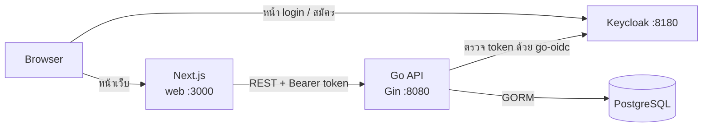
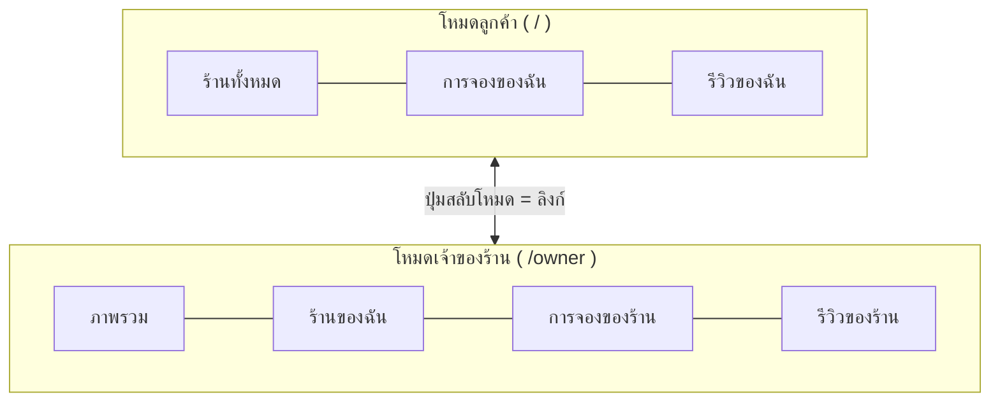
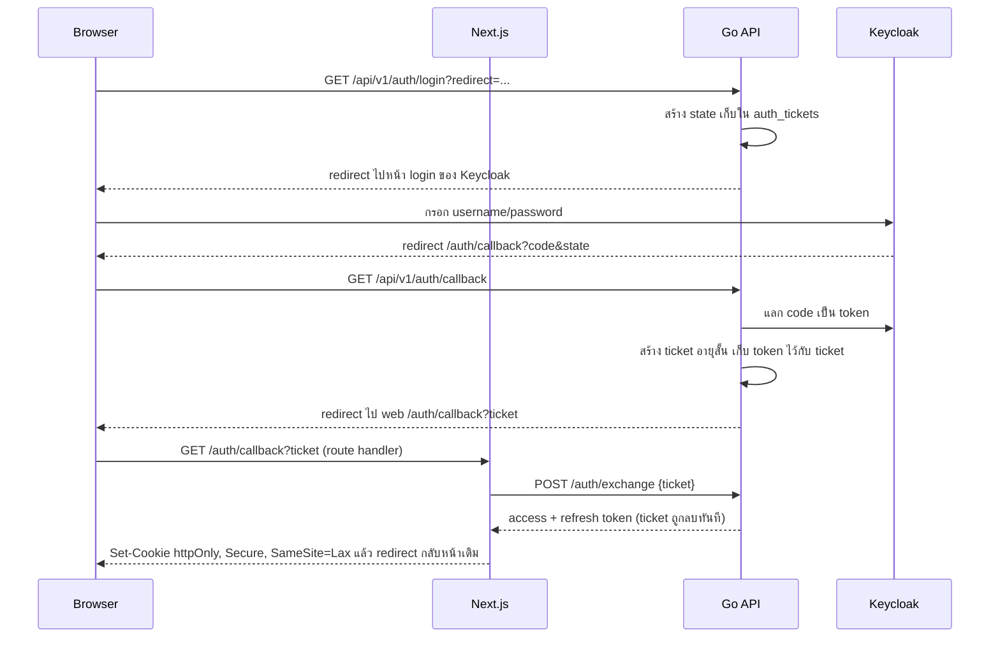
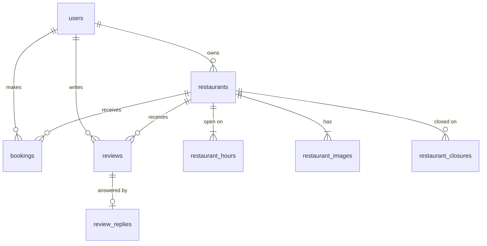
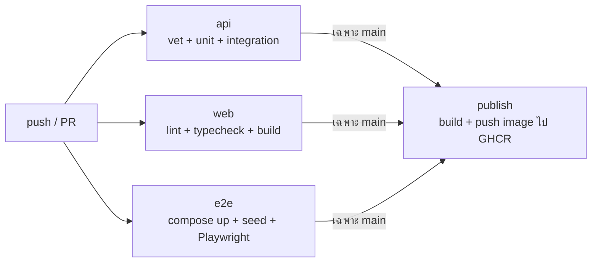

# TableTime: Architecture

TableTime เป็นเว็บจองโต๊ะร้านอาหารพร้อม community รีวิวร้าน ผู้ใช้หนึ่งบัญชีเป็นได้ทั้ง **เจ้าของร้าน** (ร้านของตัวเอง) และ **ลูกค้าและผู้รีวิว** (ร้านของคนอื่น)

เอกสารนี้อธิบายโครงสร้างระบบ ข้อมูล กติกาสำคัญ และเหตุผลของการตัดสินใจแต่ละข้อ

---

## 1. ภาพรวมระบบ



| ส่วน | เทคโนโลยี | หน้าที่ |
|---|---|---|
| web | Next.js 16, React 19, Tailwind v4, shadcn, lucide, ฟอนต์ Prompt | หน้าเว็บทั้งสองโหมด เก็บ token ใน httpOnly cookie |
| api | Go, Gin, GORM, goose, go-oidc, swaggo | กติกาทั้งหมด (ร้าน จอง รีวิว สิทธิ์) |
| auth | Keycloak (realm `tabletime`) | สมัคร login ออก token |
| db | PostgreSQL 17 | ข้อมูลทั้งหมด รวมถึง auth ticket ชั่วคราว |
| test | testify, mockery, testcontainers, Playwright | unit, integration, e2e |
| CI/CD | GitHub Actions, GHCR | test ทุก PR, push image เมื่อ merge เข้า main |

### โครง repo

```
finalExam/
├── api/                  Go API
│   ├── cmd/api/          main: ประกอบ dependency + route
│   ├── cmd/seed/         ใส่ข้อมูลตัวอย่าง
│   ├── internal/
│   │   ├── apperror/     รูปแบบ error กลาง {code, message, details}
│   │   ├── auth/         login ticket flow (จาก wongnok)
│   │   ├── middleware/   JWT
│   │   ├── user/
│   │   ├── restaurant/
│   │   ├── booking/      rules.go = กติกาเวลาและที่นั่ง (pure function)
│   │   └── review/
│   └── migrations/       goose SQL
├── web/                  Next.js
│   ├── app/(customer)/   โหมดลูกค้า
│   ├── app/owner/        โหมดเจ้าของร้าน
│   ├── app/auth/         callback + logout route handlers
│   └── lib/              api.ts, session.ts, errors.ts
├── e2e/                  Playwright
├── keycloak/import/      realm + user ทดสอบ
├── design/               ผลจาก Claude Design
├── docs/                 PLAN, ARCHITECTURE, design-prompts, walkthrough/
├── .github/workflows/    ci.yml
└── compose.yml
```

### ชั้นใน Go (ตาม pattern ของ wongnok)

แต่ละ domain มี `model.go`, `dto.go`, `error.go`, `repository.go`, `service.go`, `handler.go`

```
handler  → แปลง HTTP ↔ DTO, map error → status code
service  → กติกาที่ไม่ต้องใช้ DB (test ด้วย mock จาก mockery)
repository → SQL + transaction + lock (test ด้วย Postgres จริงผ่าน testcontainers)
```

แต่ละชั้นรับชั้นถัดไปเป็น **interface** เพื่อให้ test แทนด้วย mock ได้

---

## 2. หนึ่งบัญชี สองโหมด



- **ดูโหมดจาก URL** `/owner/...` = โหมดเจ้าของร้าน หน้าอื่นเป็นโหมดลูกค้า ไม่ต้องเก็บ state ใด ๆ แต่ละโหมดมี `layout.tsx` ของตัวเอง
- **API ไม่รู้จักโหมด** สิทธิ์ตรวจจากความเป็นเจ้าของ (`restaurant.owner_id == user.id`) เสมอ โหมดมีไว้ช่วยเรื่อง UX ส่วนความปลอดภัยอยู่ที่ API
- ยังไม่ login: เห็นเฉพาะโหมดลูกค้า ไม่มีปุ่มสลับ และเข้า `/owner` ไม่ได้
- ร้านของตัวเองในโหมดลูกค้า: แสดงในรายการตามปกติพร้อมป้าย "ร้านของคุณ" + ลิงก์ไปจัดการ ฟอร์มจองใช้ได้ (owner จองร้านตัวเองได้) แต่**ไม่มีฟอร์มรีวิว**
- หลัง login กลับไปหน้าเดิม ถ้าไม่มีหน้าเดิมให้ไปโหมดลูกค้า

### หน้าเว็บ

| โหมด | path | หน้า |
|---|---|---|
| ลูกค้า | `/` | รายการร้าน (Highest rated / Most reviewed, ค้นหา, กรองประเภทอาหาร) |
| ลูกค้า | `/restaurants/[id]` | รายละเอียดร้าน แกลเลอรี เวลาเปิด ฟอร์มจอง + กราฟที่นั่ง รีวิว |
| ลูกค้า | `/bookings/[id]` | ใบจอง (หน้าจองสำเร็จ) |
| ลูกค้า | `/my-bookings` | การจองของฉัน |
| ลูกค้า | `/my-reviews` | รีวิวของฉัน |
| ลูกค้า | `/users/[id]` | โปรไฟล์ผู้รีวิว (public) |
| เจ้าของร้าน | `/owner` | ภาพรวม (งานหลัก redirect ไป `/owner/restaurants`) |
| เจ้าของร้าน | `/owner/restaurants` | ร้านของฉัน |
| เจ้าของร้าน | `/owner/restaurants/new` | สร้างร้าน |
| เจ้าของร้าน | `/owner/restaurants/[id]` | จัดการร้าน แท็บ ข้อมูล / การจอง / รีวิว / วันหยุด |
| เจ้าของร้าน | `/owner/bookings` | การจองของทุกร้านของฉัน |
| เจ้าของร้าน | `/owner/reviews` | รีวิวของทุกร้านของฉัน + ตอบรีวิว |

---

## 3. Login และ session

ใช้ ticket flow ของ wongnok เพื่อไม่ให้ token ไปอยู่ใน URL และเก็บ token เป็น **httpOnly cookie** ที่ JavaScript ฝั่ง browser อ่านไม่ได้



- Server Component อ่าน cookie แล้วเรียก Go พร้อม `Authorization: Bearer` (`lib/api.ts`)
- **Refresh อยู่ที่เดียว** ใน `lib/session.ts`: ถ้า access token ใกล้หมดอายุ ให้เรียก `/auth/refresh-token` แล้วตั้ง cookie ใหม่ ถ้า refresh ไม่ผ่านให้ลบ cookie แล้วพาไป login
- Go ตรวจ token ทุก request ใน `middleware.JWT` ด้วย `oidc.IDTokenVerifier` (ตรวจลายเซ็น, อายุ, audience) แล้วหา user จาก `uid`

---

## 4. Data model



| ตาราง | คอลัมน์สำคัญ | constraint |
|---|---|---|
| `users` | `id` (uuid), `uid` (Keycloak sub), `email`, `name` | จาก wongnok |
| `restaurants` | `id`, `owner_id`, `name`, `description`, `cuisine`, `seats`, `cancel_minutes`, `average_rating` NUMERIC(3,2), `review_count`, timestamps, `deleted_at` | `seats > 0`, `cancel_minutes >= 30` default 30, index `(owner_id)` |
| `restaurant_hours` | `restaurant_id`, `weekday` (0=อาทิตย์…6), `open_all_day` BOOL, `open_time` TIME, `close_time` TIME | PK `(restaurant_id, weekday)`, ถ้า `open_all_day` เวลาต้องเป็น NULL ถ้าไม่ใช่ต้องมีทั้งคู่และ `open_time <> close_time` |
| `restaurant_images` | `id`, `restaurant_id`, `url`, `position` | อย่างน้อย 1 รูป (ตรวจที่ service) |
| `bookings` | `id`, `restaurant_id`, `user_id`, `party_size`, `start_at`, `end_at` TIMESTAMPTZ, `cancel_deadline` TIMESTAMPTZ, `status` (`active`/`cancelled`), timestamps | `party_size > 0`, `end_at > start_at`, index `(restaurant_id, start_at)`, `(user_id)` |
| `reviews` | `restaurant_id`, `user_id`, `rating`, `comment`, timestamps | PK `(user_id, restaurant_id)`, `rating BETWEEN 1 AND 5` |
| `auth_tickets` | `key`, `payload` JSONB, `expires_at` | ใช้แทน Redis |
| `restaurant_closures` *(ต่อยอด)* | `restaurant_id`, `date` DATE, `note` | PK `(restaurant_id, date)` |
| `review_replies` *(ต่อยอด)* | `restaurant_id`, `user_id`, `body`, timestamps | PK = FK ไป reviews (1 คำตอบต่อรีวิว) |

- วันที่ไม่มีแถวใน `restaurant_hours` = ร้านปิดวันนั้น ต้องมีอย่างน้อย 1 แถว
- **เวลาทั้งหมดเป็นเวลาไทย** `TIMESTAMPTZ` เก็บเวลาที่แน่นอน ส่วน `TIME` ใน `restaurant_hours` หมายถึงเวลาตาม `Asia/Bangkok` Go โหลด `time.LoadLocation("Asia/Bangkok")` ครั้งเดียวตอนเริ่มโปรแกรมแล้วส่งต่อไปใช้

---

## 5. กติกาการจอง

### 5.1 ตรวจอะไรบ้าง (ตามลำดับ)

| # | กติกา | ที่ไหน | error |
|---|---|---|---|
| 1 | body ครบและถูกรูปแบบ, `party_size ≥ 1` | handler (binding) | 400 `VALIDATION_FAILED` |
| 2 | เวลาลงช่อง 30 นาที (:00 / :30) | service | 422 `INVALID_TIME_SLOT` |
| 3 | ยาว ≥ 60 นาที | service | 422 `BOOKING_TOO_SHORT` |
| 4 | `start_at` อยู่ในอนาคต | service | 422 `BOOKING_IN_PAST` |
| 5 | อยู่ใน**ช่วงเปิดช่วงเดียว** | service | 422 `OUTSIDE_OPENING_HOURS` |
| 6 | ไม่ใช่วันหยุดเฉพาะวัน *(ต่อยอด)* | service | 422 `RESTAURANT_CLOSED_ON_DATE` |
| 7 | (แก้/ยกเลิก) เป็นการจองของตัวเอง | service | 403 `NOT_BOOKING_OWNER` |
| 8 | (แก้/ยกเลิก) ยังไม่เลย `cancel_deadline` | service | 422 `CANCEL_DEADLINE_PASSED` |
| 9 | ที่นั่งไม่เกินในทุกช่อง 30 นาที | repository (ใน transaction) | 409 `NOT_ENOUGH_SEATS` |

### 5.2 ช่วงเปิดและร้านข้ามเที่ยงคืน

แต่ละแถวใน `restaurant_hours` สร้าง **ช่วงเปิดจริง** ของวันนั้น 1 ช่วง:

- `open_all_day` → วันนั้น 00:00 ถึงวันถัดไป 00:00
- `close_time > open_time` → วันนั้น open ถึงวันนั้น close
- `close_time < open_time` → วันนั้น open ถึง**วันถัดไป** close (ข้ามเที่ยงคืน นับเป็นของวันที่เปิด)

การจองต้องอยู่ในช่วงเปิด**ช่วงเดียว** ฟังก์ชัน `openWindowFor` สร้างช่วงเปิดของวันของ `start_at` และของวันก่อนหน้า (เผื่อเป็นช่วงข้ามเที่ยงคืนของเมื่อวาน) แล้วดูว่าช่วงไหนครอบ `[start_at, end_at]` ได้ทั้งหมด

ตัวอย่าง ร้านเปิดเสาร์ 18:00–02:00:

| จอง | ผล | เหตุผล |
|---|---|---|
| เสาร์ 23:00–อาทิตย์ 01:00 | ✅ | อยู่ในช่วงเสาร์ 18:00–อาทิตย์ 02:00 |
| อาทิตย์ 01:00–02:00 | ✅ | ช่วงของวันเสาร์ (วันก่อนหน้า) ครอบได้ |
| อาทิตย์ 01:30–02:30 | ❌ | เลย 02:00 |
| ร้านเปิด 24 ชม. ทั้งเสาร์และอาทิตย์ จอง เสาร์ 23:00–อาทิตย์ 01:00 | ❌ | คร่อมสองช่วง (ตัดสินใจให้เป็นกติกาเดียวที่ใช้ได้ทุกกรณี) |

หน้าเว็บให้เลือก "วันที่" เป็นวันที่ร้านเปิดรอบนั้น แล้ว dropdown แสดงเวลาต่อเนื่อง เช่น 18:00 … 23:30, 00:00 (ถัดไป) … ส่วนการแปลงเป็น `start_at`/`end_at` เต็ม ๆ ทำที่หน้าเว็บ Go ตรวจอีกรอบตามตารางด้านบน

### 5.3 ที่นั่ง: นับรายช่อง 30 นาที

สไลด์: "ไม่ว่าเวลาไหน จำนวนคนที่จองรวมกันต้องไม่เกินจำนวนที่นั่ง" การจองทุกรายการลงช่อง 30 นาทีพอดี จำนวนคนภายในช่องหนึ่งจึงคงที่ทั้งช่อง **จึงตรวจแค่ทีละช่องก็ครบทุกเวลา**

```
seatsUsedPerSlot(bookings, start, end):
    สำหรับแต่ละช่อง t = start, start+30m, … < end
        used[t] = ผลรวม party_size ของการจองที่ start_at <= t < end_at
ตรวจ: ทุกช่อง used[t] + party_size <= seats
```

ตัวอย่างในสไลด์ (ร้าน 10 ที่): A 7 (12:00–12:30), B 7 (12:30–13:00) แล้ว C ขอ 3 (12:00–13:00)

| ช่อง | ใช้อยู่ | + C | ≤ 10? |
|---|---|---|---|
| 12:00 | 7 (A) | 10 | ✅ |
| 12:30 | 7 (B) | 10 | ✅ |

**C จองได้** ถึง A + B + C = 17 เพราะ A กับ B ไม่ได้อยู่พร้อมกัน วิธีที่ผิดคือรวมทุกการจองที่ทับกับช่วงที่ขอ

(A และ B ยาว 30 นาที ซึ่งกติกาเราไม่รับ เพราะจองได้ขั้นต่ำ 1 ชม. ตัวเลขนี้จึงใช้ทดสอบฟังก์ชัน `seatsUsedPerSlot` โดยตรง ส่วน integration test ใช้เคสเดียวกันที่ขยายเป็นช่วงละ 1 ชม.)

ตอน**แก้ไข** ให้ดึงการจองโดยตัดการจองเดิมของตัวเองออก (`id <> ?`) ถ้าไม่ตัด ที่นั่งเดิมของ A จะถูกนับซ้ำกับที่นั่งใหม่

`GET /restaurants/:id/availability?date=` ใช้ฟังก์ชันเดียวกัน แล้วคืน `seats - used[t]` ของทุกช่องในช่วงเปิดของวันนั้น ซึ่งเป็นข้อมูลที่ใช้ทั้งกราฟที่นั่งและป้าย Limited Seats Left! (เหลือ ≤ 3 ที่)

### 5.4 สองคนกดพร้อมกัน

```mermaid
sequenceDiagram
    participant X as คำขอ X (6 ที่)
    participant Y as คำขอ Y (6 ที่)
    participant DB as Postgres
    X->>DB: BEGIN; SELECT ... FROM restaurants WHERE id=1 FOR UPDATE
    Y->>DB: BEGIN; SELECT ... FOR UPDATE (รอ)
    X->>DB: อ่านการจองที่ทับ → เหลือ 6 → INSERT
    X->>DB: COMMIT (ปล่อย lock)
    DB-->>Y: ได้ lock
    Y->>DB: อ่านการจองที่ทับ → เหลือ 0 → ROLLBACK
    Note over Y: 409 NOT_ENOUGH_SEATS
```

- lock **แถวร้าน** ไม่ใช่แถวการจอง เพราะตอนตรวจ การจองใหม่ยังไม่มีแถวให้ lock
- คำขอของร้านอื่นไม่ต้องรอกัน เพราะ lock เป็นรายร้าน
- test: race test ใช้ goroutine หลายตัวยิงพร้อมกันกับ Postgres จริง

### 5.5 ยกเลิกและแก้ไข

- `cancel_deadline = start_at - cancel_minutes` **คำนวณและเก็บตอนจอง** ถ้าเจ้าของร้านเปลี่ยน `cancel_minutes` ภายหลังจะไม่กระทบการจองที่มีอยู่ ถ้าแก้เวลาการจอง ให้คำนวณ deadline ใหม่จากเวลาเริ่มใหม่
- **แก้ไขใช้กติกาเดียวกับยกเลิก** ต้องทำก่อน `cancel_deadline` ไม่อย่างนั้นลูกค้าจะลดจำนวนคนเหลือ 1 ก่อนเข้าร้าน 5 นาทีได้ ซึ่งเท่ากับยกเลิกเลยเวลา
- แก้ได้ทุกช่อง (จำนวนคน วันที่ เวลา) และตรวจกติกา 5.1 ใหม่ทั้งหมด
- ยกเลิก = `status = 'cancelled'` (ไม่ลบแถว) การคำนวณที่นั่งดูเฉพาะ `status = 'active'`

### 5.6 เมื่อเจ้าของร้านเปลี่ยนกติกา

หลักคือ **กติกาใหม่ไม่กระทบการจองที่รับไปแล้ว**

- ลดที่นั่ง หรือเปลี่ยนเวลาเปิด: ทำได้ การจองเดิมยังอยู่ กติกาใหม่ใช้กับการจองใหม่และการแก้ไข
- เพิ่มวันหยุดเฉพาะวันที่มีการจอง *(ต่อยอด)*: API ตอบ 409 `CLOSURE_HAS_BOOKINGS` พร้อมจำนวนการจอง หน้าเว็บแสดงเป็น **dialog ยืนยัน** (ไม่ใช่ error) ถ้ากดยืนยันจะส่ง `confirm=true` การจองเดิมยังอยู่
- ลบร้านที่ยังมีการจองในอนาคต: ไม่ได้ (409) เพราะลบร้านแล้วการจองที่รับไว้จะไม่มีร้านรองรับ

---

## 6. รีวิวและการจัดอันดับ

- 1 รีวิวต่อคนต่อร้าน (PK `(user_id, restaurant_id)`) แก้และลบได้ ไม่ต้องเคยจองก่อน (เหมือน Google Maps)
- รีวิวร้านตัวเองไม่ได้ → 403 `CANNOT_REVIEW_OWN` หน้าเว็บไม่แสดงฟอร์ม แต่ API กันไว้อีกชั้น
- **ค่าเฉลี่ยเก็บไว้ในตารางร้าน** ทุกครั้งที่สร้าง แก้ หรือลบรีวิว: lock แถวร้าน → เขียนรีวิว → `SELECT AVG(rating), COUNT(*)` → อัปเดตร้าน ใน transaction เดียว
  - เหตุผล: หน้ารายการร้านถูกเปิดบ่อยกว่ามีรีวิวใหม่มาก และ sort ด้วยคอลัมน์ที่เก็บไว้เร็วกว่าคำนวณสด การคำนวณใหม่จากตาราง (แทนการบวกเพิ่มทีละรีวิว) ทำให้ค่าไม่เพี้ยนแม้จะเป็นการแก้หรือลบ
- **Highest rated:** `ORDER BY (review_count >= 3) DESC, average_rating DESC, review_count DESC` ร้านที่มีรีวิวน้อยกว่า 3 ไปอยู่ท้ายรายการ
  - ตอบคำถาม "5.0 จาก 1 รีวิว vs 4.8 จาก 300 รีวิว": ร้าน 4.8 อยู่ก่อน เพราะรีวิวเดียวยังเชื่อถือไม่ได้ ที่เลือกใช้เกณฑ์ขั้นต่ำแทนสูตร Bayesian เพราะผู้ใช้เข้าใจได้ทันที
- **Most reviewed:** `ORDER BY review_count DESC, average_rating DESC`
- ชื่อผู้รีวิวใช้ `users.name` ที่มาจาก Keycloak
- *(ต่อยอด)* เจ้าของร้านตอบได้รีวิวละ 1 ข้อความ ถ้า `review.updated_at > reply.created_at` แสดงป้าย "รีวิวถูกแก้ไขหลังร้านตอบ"

---

## 7. API

prefix `/api/v1` ดูรายละเอียดทั้งหมดที่ Swagger `/swagger/index.html`

| method | path | login | หมายเหตุ |
|---|---|---|---|
| GET | `/auth/login`, `/auth/callback` | – | จาก wongnok |
| POST | `/auth/exchange`, `/auth/refresh-token`, `/auth/logout` | – | |
| GET | `/restaurants` | – | `sort`, `page`, `limit`, `q`\*, `cuisine`\*, `date/start/end/party`\* |
| GET | `/restaurants/:id` | – | รวม hours, images, rating breakdown, `is_owner` (ถ้า login) |
| GET | `/restaurants/:id/availability?date=` | – | ที่ว่างรายช่อง 30 นาที |
| GET | `/restaurants/:id/reviews` | – | ใหม่สุดก่อน |
| POST | `/restaurants` | ✔ | |
| PUT / DELETE | `/restaurants/:id` | ✔ เจ้าของ | |
| GET | `/me/restaurants` | ✔ | |
| POST | `/restaurants/:id/bookings` | ✔ | |
| GET | `/me/bookings` | ✔ | |
| PUT | `/bookings/:id` | ✔ ผู้จอง | |
| POST | `/bookings/:id/cancel` | ✔ ผู้จอง | |
| POST | `/restaurants/:id/reviews` | ✔ ไม่ใช่เจ้าของ | |
| PUT / DELETE | `/restaurants/:id/reviews/me` | ✔ | |
| GET | `/restaurants/:id/bookings?date=`\* | ✔ เจ้าของ | |
| GET | `/me/reviews`\* | ✔ | |
| GET | `/me/restaurant-reviews`\* | ✔ | รีวิวของทุกร้านของฉัน |
| GET | `/users/:id/profile`\* | – | โปรไฟล์ผู้รีวิว |
| GET / POST / DELETE | `/restaurants/:id/closures`\* | ✔ เจ้าของ | POST รับ `confirm` |
| PUT / DELETE | `/restaurants/:id/reviews/:userId/reply`\* | ✔ เจ้าของ | |

\* = ต่อยอด

---

## 8. Error

Go ตอบ error รูปแบบเดียวเสมอ:

```json
{ "code": "NOT_ENOUGH_SEATS", "message": "not enough seats", "details": { "slot": "2026-10-11T12:30:00+07:00", "remaining": 3 } }
```

`message` มีไว้สำหรับนักพัฒนา **หน้าเว็บไม่แสดงค่านี้** แต่ใช้ `code` เปิดตารางข้อความไทยใน `web/lib/errors.ts` และเติมตัวเลขจาก `details`

| code | HTTP | ข้อความที่ผู้ใช้เห็น |
|---|---|---|
| `VALIDATION_FAILED` | 400 | แสดงใต้ช่องที่ผิดตาม `details.fields` |
| `UNAUTHORIZED` | 401 | (ไม่แสดง) พาไปหน้า login แล้วกลับหน้าเดิม |
| `NOT_OWNER` | 403 | คุณไม่ใช่เจ้าของร้านนี้ |
| `NOT_BOOKING_OWNER` | 403 | การจองนี้ไม่ใช่ของคุณ |
| `CANNOT_REVIEW_OWN` | 403 | รีวิวร้านของตัวเองไม่ได้ |
| `RESTAURANT_NOT_FOUND` | 404 | ไม่พบร้านนี้ อาจถูกลบไปแล้ว |
| `BOOKING_NOT_FOUND` | 404 | ไม่พบการจองนี้ |
| `REVIEW_NOT_FOUND` | 404 | ไม่พบรีวิวนี้ |
| `NOT_ENOUGH_SEATS` | 409 | ช่วง {slot} เหลือที่นั่ง {remaining} ที่ ลองลดจำนวนคนหรือเลือกเวลาอื่น |
| `REVIEW_ALREADY_EXISTS` | 409 | คุณรีวิวร้านนี้แล้ว แก้ไขรีวิวเดิมได้ |
| `BOOKING_ALREADY_CANCELLED` | 409 | การจองนี้ถูกยกเลิกไปแล้ว |
| `RESTAURANT_HAS_FUTURE_BOOKINGS` | 409 | ลบร้านไม่ได้ เพราะยังมีการจองที่ยังไม่ถึงเวลา {count} รายการ |
| `CLOSURE_HAS_BOOKINGS` | 409 | (dialog ยืนยัน) วันนี้มีการจอง {count} รายการ การจองเหล่านี้จะยังอยู่ ยืนยันตั้งเป็นวันหยุดไหม |
| `INVALID_TIME_SLOT` | 422 | กรุณาเลือกเวลาที่ลงท้ายด้วย :00 หรือ :30 |
| `BOOKING_TOO_SHORT` | 422 | จองได้อย่างน้อย 1 ชั่วโมง |
| `BOOKING_IN_PAST` | 422 | เวลานี้ผ่านไปแล้ว กรุณาเลือกเวลาใหม่ |
| `OUTSIDE_OPENING_HOURS` | 422 | ร้านไม่เปิดในช่วงเวลานี้ |
| `RESTAURANT_CLOSED_ON_DATE` | 422 | ร้านปิดในวันที่เลือก |
| `CANCEL_DEADLINE_PASSED` | 422 | เลยเวลาที่แก้ไขหรือยกเลิกได้แล้ว ({deadline}) |
| `INTERNAL_ERROR` / code อื่น | 500 | เกิดข้อผิดพลาด ลองใหม่อีกครั้ง |

- 422 ใช้กับ "ข้อมูลถูกรูปแบบแต่ผิดกติกา" ส่วน 409 ใช้กับ "ชนกับสถานะที่มีอยู่"
- handler map error → status ที่จุดเดียวต่อ domain (`handler.go` ฟังก์ชัน `writeError`)

---

## 9. Testing

| ชั้น | เครื่องมือ | ครอบคลุม |
|---|---|---|
| Unit: pure function | testify | `booking/rules.go`: ช่วงเปิด (ปกติ, ข้ามเที่ยงคืน, 24 ชม., ปิด), ช่อง 30 นาที, ≥ 1 ชม., ที่นั่งรายช่อง (ตัวเลขจากสไลด์), deadline |
| Unit: service | testify + mockery | ลำดับการตรวจ, ความเป็นเจ้าของ, รีวิวร้านตัวเองไม่ได้, error ที่คืน |
| Unit: handler | testify + httptest | status code และ JSON error ของแต่ละ error |
| Integration | testify + testcontainers (Postgres จริง) | repository, เคสที่นั่งจากสไลด์, แก้ไขแล้วไม่นับตัวเอง, ค่าเฉลี่ยรีวิว, sort |
| Race | testcontainers + goroutine | สองคนขึ้นไปจองพร้อมกัน |
| E2E | Playwright | 5 flow ผ่าน browser จริง (ดู PLAN ขั้น 11) ทุกครั้งเริ่มจาก seed |

กติกาละเอียดทดสอบที่ Go ส่วน e2e ทดสอบว่าผู้ใช้ทำงานได้ครบ flow และเห็นข้อความภาษาคน

---

## 10. CI/CD



- ไฟล์เดียว `.github/workflows/ci.yml`
- `e2e` รันทุก PR อัปโหลด Playwright trace และวิดีโอเป็น artifact เมื่อ fail
- `publish` ใช้ `GITHUB_TOKEN` push `ghcr.io/<owner>/tabletime-api` และ `tabletime-web` tag ด้วย `latest` และ commit SHA
- ไม่มีการ deploy ขึ้น server (โจทย์ไม่บังคับ) image บน GHCR นำไปรันที่ไหนก็ได้

---

## 11. Decisions

| # | เรื่อง | เลือก | เหตุผล |
|---|---|---|---|
| D1 | Login | Keycloak + go-oidc (ticket flow จาก wongnok) | ไม่ต้องเก็บ password เอง ใช้ระบบที่ออกแบบมาเพื่อ auth และเคยเรียนแล้ว |
| D2 | เก็บ token | httpOnly cookie ที่ Next.js ตั้ง | JS อ่านไม่ได้ (กัน XSS ขโมย token) และ Server Component ใช้ได้ |
| D3 | Redis | ไม่ใช้ | โจทย์ไม่มีจุดที่ต้องใช้ cache ลดจำนวน service ลงหนึ่งตัว |
| D4 | auth state/ticket | ตาราง `auth_tickets` ใน Postgres (`DELETE … RETURNING` = ใช้ได้ครั้งเดียว, มี `expires_at`) | ใช้แทน Redis ในโค้ดเดิม อยู่รอดตอน restart และไม่ต้องเพิ่ม service |
| D5 | เวลาเปิด | `restaurant_hours` วันละ 1 ช่วง + `open_all_day` | รองรับวันหยุดประจำสัปดาห์ เวลาต่างกันรายวัน และ 24 ชม. ตั้งแต่แรก |
| D6 | ข้ามเที่ยงคืน | `close < open` = ปิดวันถัดไป นับเป็นของวันที่เปิด | ตรงกับที่คนเข้าใจว่าเป็น "คืนวันเสาร์" |
| D7 | ช่วงจอง | ช่อง 30 นาที ≥ 1 ชม. อยู่ในช่วงเปิดช่วงเดียว | ตรวจที่นั่งทีละช่องได้ง่าย UI เป็น dropdown ได้ |
| D8 | กันจองชน | `FOR UPDATE` แถวร้าน ใน transaction | ง่ายที่สุดที่ถูกต้อง และ lock เฉพาะร้านนั้น |
| D9 | ยกเลิก | `status = cancelled` | เก็บประวัติให้ทั้งลูกค้าและเจ้าของร้าน |
| D10 | deadline | เก็บ `cancel_deadline` ตอนจอง | กติกาไม่เปลี่ยนหลังลูกค้าจองแล้ว |
| D11 | แก้การจอง | แก้ได้ทุกช่อง แต่ต้องก่อน deadline | กันการใช้การแก้ไขแทนการยกเลิกเลยเวลา |
| D12 | เจ้าของเปลี่ยนกติกา | การจองเดิมยังอยู่ | ร้านรับปากลูกค้าไปแล้ว และโค้ดง่ายกว่า |
| D13 | ค่าเฉลี่ยรีวิว | เก็บในตารางร้าน คำนวณใหม่ใน transaction | อ่านบ่อยกว่าเขียนมาก |
| D14 | Highest rated | รีวิว < 3 ไปท้ายรายการ | อธิบายให้ผู้ใช้เข้าใจได้ในประโยคเดียว |
| D15 | รีวิว | 1 ต่อคนต่อร้าน ไม่ต้องเคยจอง | เหมือน Google Maps ลดความซับซ้อน |
| D16 | สองบทบาท | สวิตช์โหมดตาม URL `/owner` | ไม่ต้องเก็บ state แชร์ลิงก์ได้ API ยังตรวจสิทธิ์ตามความเป็นเจ้าของ |
| D17 | error | `{code, message, details}` + ตารางข้อความไทยที่ web | ผู้ใช้ไม่เห็นข้อความภาษาโค้ด |
| D18 | รูปร้าน | URL | ไม่ต้องมีที่เก็บไฟล์และการตรวจไฟล์ |
| D19 | Timezone | `Asia/Bangkok` คงที่ | ระบบใช้ในไทยเท่านั้น |
| D20 | CD | push image ขึ้น GHCR ไม่ deploy | ได้ artifact ที่นำไปรันได้จริง โดยไม่ต้องดูแล server |
| D21 | Keycloak ใน compose | `KC_HOSTNAME=http://localhost:8180` + `KC_HOSTNAME_BACKCHANNEL_DYNAMIC`, api เรียก `http://keycloak:8080` แต่ตรวจ issuer เป็น `KEYCLOAK_PUBLIC_URL` (`oidc.InsecureIssuerURLContext`) | browser กับ api เข้าถึง Keycloak คนละ URL แต่ token ต้องมี issuer เดียว ถ้าไม่ทำ login ผ่าน `docker compose up` ไม่ได้ |
| D22 | secret ใน realm file | ใช้ `${KEYCLOAK_CLIENT_SECRET}` ให้ Keycloak แทนค่าจาก env ตอน import และไม่เก็บ key ของ realm ในไฟล์ | ไม่มี secret จริงใน repo และใช้ค่าเดียวกันทั้ง Keycloak และ api |
| D23 | login ด้วย username | ปิด `registrationEmailAsUsername` ของ realm | user ทดสอบ login ด้วย `alice` / `bob` / `carol` ได้ (ใช้อีเมลได้ด้วย) |
